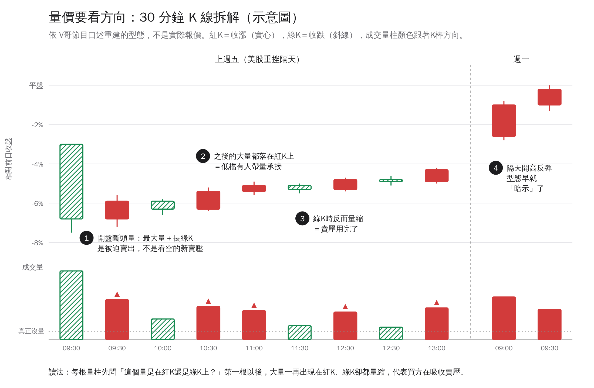

# 量價看方向：大跌日 30/60 分 K 判讀法

（來源：2026-11-09 財經節目，V哥的觀念。台股慣例：紅K＝收漲，綠K＝收跌。）

## 觀念
量不能只看大小，要看量出在哪個方向的 K 棒上。日 K 會把一整天壓成一根，看不出量是在殺低還是在拉回時出的。遇到很多股票鎖漲跌停時，日 K 的量也會失真。所以大跌那天要切到 30 分或 60 分 K 拆開來看。

## 判讀步驟
1. **第一根開盤爆量長綠K**：如果是外部利空（例如前一晚美股重挫）造成的斷頭或被迫賣出，就當成賣壓出清，不當成空方訊號。
2. **從第二根開始看**：大量是出在紅K還是綠K？大量多出在紅K，代表低檔有人帶量承接。
3. **綠K時量縮**：回檔時的量縮到接近「真正沒量」的水準，代表賣壓已經用完。
4. **低點要一路墊高**：只有量的方向對、低點卻一直破，不算止跌。
5. **失效條件**：隔天如果出現帶量綠K、跌破前一天的低點，訊號就失效，要照停損處理。
6. **升級成進場訊號的條件**：法人財測沒有大幅下修，而且外資開始回補。

## 速查表
| 型態 | 解讀 |
|---|---|
| 大量＋綠K，之後綠K繼續帶量 | 賣壓還沒完，不要急著接 |
| 第一根大量綠K，之後大量在紅K、綠K量縮 | 斷頭出清加上低檔承接，是反彈訊號 |
| 紅K但量很小 | 反彈沒人跟，容易再跌 |
| 紅K帶量，而且低點墊高 | 買盤真的進場，可以開始觀察進場點 |

## 在 TradingView 上的做法
- 時間週期切到 30 分（或 60 分），並開啟成交量（Volume）。
- 量柱的顏色要跟 K 棒漲跌一致。台股習慣紅漲綠跌，記得在設定裡把顏色對調。
- 鎖定大跌那天，從第二根開始，逐根記錄「量大小」和「紅或綠」，並確認低點有沒有墊高。
- 隔天開盤後檢查有沒有帶量綠K跌破前一天的低點（失效條件）。

## 限制
這只是短線的止跌訊號，說明的是「當下賣壓出清」，不保證趨勢會反轉。部位控制和停損一定要先設好。
